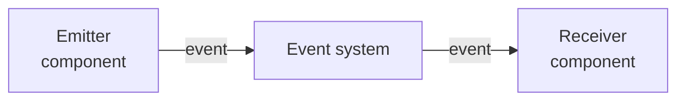
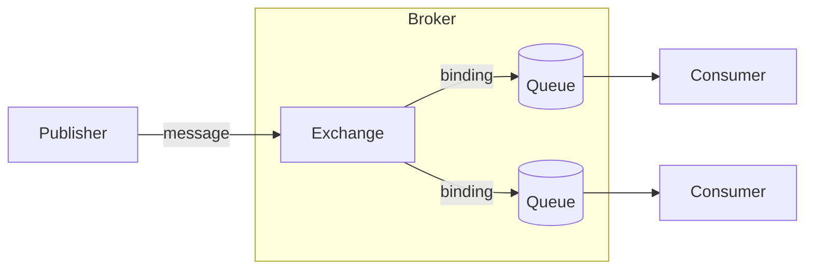
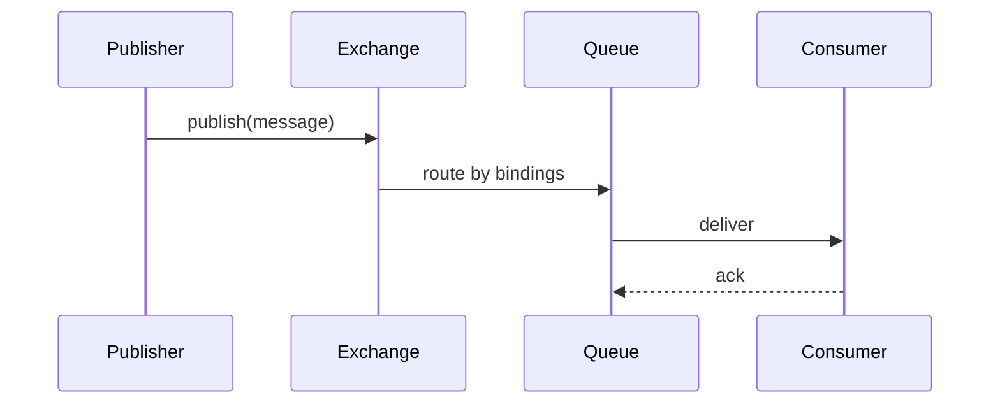
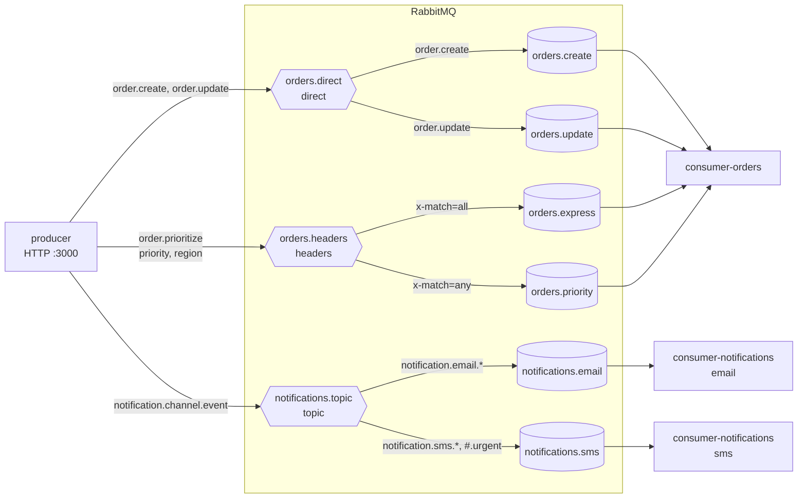

# Event-driven architecture

This repo is an implementation of an **event-driven architecture**. Its purpose is to show how an event-driven architecture works, list its advantages, and explain why this architecture turns out to be really useful when designing systems.

> *This branch is about the **RabbitMQ** implementation. It starts with the theory behind event-driven systems; if you already know it, or it isn't what you're looking for, feel free to jump directly to [AMQP](#amqp), the protocol RabbitMQ is built on, where the RabbitMQ part begins.*

---

## Technology

Since there are many different entities involved in the implementation, each tool has a specific role:

- **NestJS** + **TypeScript**: framework and language of every service in the example.
- **Docker Compose**: builds and runs every entity together, with a single command.
- **Postman**: [postman_collection.json](postman_collection.json) lets you test the whole process yourself.

---

## Literature

Event-driven is just a pattern that defines a workflow; any technology is one representation of that theory. Here are some docs about it:

- [What do you mean by "Event-Driven"?](https://martinfowler.com/articles/201701-event-driven.html) — Martin Fowler
- [Formalizing Design Spaces: Implicit Invocation Mechanisms](https://kilthub.cmu.edu/articles/journal_contribution/Formalizing_design_spaces_Implicit_invocation_mechanisms/6605828?file=12096311) — David Garlan, David Notkin
- [An Introduction to Software Architecture](https://userweb.cs.txstate.edu/~rp31/papersSA/intro_softarch.pdf) — David Garlan, Mary Shaw
- [AMQP 0-9-1 specification](https://www.rabbitmq.com/resources/specs/amqp0-9-1.pdf) — the protocol behind RabbitMQ
- [Kafka: a Distributed Messaging System for Log Processing](https://people.csail.mit.edu/matei/courses/2015/6.S897/readings/kafka.pdf) — Jay Kreps, Neha Narkhede, Jun Rao


---

## Theory: implicit invocation

You can find many different implementations or representations of event-driven systems, but all of them come from the same source: **implicit invocation**, as formalized in [Formalizing Design Spaces: Implicit Invocation Mechanisms](https://kilthub.cmu.edu/articles/journal_contribution/Formalizing_design_spaces_Implicit_invocation_mechanisms/6605828?file=12096311). Before starting the explanation, it's important to go over some vocabulary, to make sure both of us are speaking the same language.

### Vocabulary

| Term | Definition |
| --- | --- |
| **Component** | A part of the system. It can contain properties and methods, which can be invoked by the same system or by an external one |
| **System** | A set of components that work together to accomplish a specific goal. It offers a service or executes some kind of operation |
| **Event** | A signal a component announces to say that something happened. Announcing it doesn't execute anything by itself, and the component that announces it doesn't know which methods will run in response, or whether any will |
| **Method** | An operation that can be executed on a component. Its function is to modify the system's state |
| **Property** | A part of a component that holds a value. Its function is to describe part of the component |

### From explicit to implicit invocation

At some point in a workflow, every component in a system needs to invoke an operation on another component. That component could be part of the same system as the invoker, or it could live in another one. When the invoker calls it directly, that is called **explicit invocation**, and it requires direct access to the other component to be able to execute the operation.

Many systems needed this kind of interaction and implemented it in many different ways. That's where **implicit invocation** came from: the main idea behind it is being able to execute operations on other components *without explicitly referencing the target component*.

As [Garlan & Shaw](https://userweb.cs.txstate.edu/~rp31/papersSA/intro_softarch.pdf) describe it, this brings two main benefits:

1. **Reuse:** any component can be added to a system just by registering it for the events of that system, without changing the others.
2. **Easier evolution:** components can be replaced, added or removed without affecting the interfaces of the other components, thanks to the **loose coupling** between them.

We can find many examples of implicit invocation in the tools we use. Just to name a few:

- A version control tool like **Git**, whose hooks run scripts when an event such as a commit happens.
- A **UI** that separates the presentation of the data from the application that manages it, so the views update in response to changes.
- A **database** that ensures its consistency constraints, running checks or triggers when the data changes.

To manage the interaction between components, [Garlan & Notkin](https://kilthub.cmu.edu/articles/journal_contribution/Formalizing_design_spaces_Implicit_invocation_mechanisms/6605828?file=12096311) define two models: a **basic model**, with the entities involved, and a **runtime model**, with how they behave.

### Basic model

Everything starts with the component definition. A component needs three things to be able to interact with the others: a **name** to identify itself, a **set of methods** and a **set of events**.

> *The model also defines two specific functions, one to extract a component's methods and one to extract its events. But since the goal of this document is just to explain how the pattern works, not to get into a specific formalization, I'm going to leave them out of scope.*

Nice, we have a component.

We also have another entity called the **event system**. It holds the components and the **event manager**, which binds each event to the methods that must be invoked when that event is **announced**.

```
Component     = { name, methods, events }
Event system  = { components, event manager }
Event manager : event  →  methods to invoke
```

So the event system is the core part of our model: it manages the behavior of all the events in a system. It has all the context required to manage the invocations and to route each request for execution.

### Runtime model

Now that we understand what an event system is, its parts, and the other entities involved in its definition, the next point is to define how it should behave. It needs two main operations to work as expected:

- The capability to let a component **announce** an event.
- A way to pick one of those events and **invoke** the methods bound to it.

To announce an event, the runtime model establishes a **set of announced events**, which are events that were raised but not yet handled, and a **method to announce** an event. It's simple: that method just adds the new event to the set of announced ones.

On the other side, we have a method to **execute the invocations**: it takes the set of methods bound to an event and invokes them, following the invocation policy the system defines, to change the state of the components in the system.

So the system handles each event in two phases:

1. **Select:** it picks an event and removes it from the set of announced events.
2. **Propagate:** it invokes the methods associated with that event.

> *It's important to understand here that each event has its own set of associated methods. That way, the event manager can invoke exactly those methods without affecting the other parts of the components.*

---

## Use cases

A lot of different technologies were built on top of implicit invocation. But more important than the specific technologies is understanding what we mean when we talk about events: "event-driven" means different things to different people, and each meaning has its own common use cases (see [What do you mean by "Event-Driven"?](https://martinfowler.com/articles/201701-event-driven.html)). Before listing each use case, it's important to understand how the parts of each one mirror the formal definition of implicit invocation.

In each example you're going to see an **emitter** (a component) that announces an event, something like a black box that propagates that event to other parts of the system (the **event system**), and a **receiver** that receives and processes the information (another component).



### Event notification

This is when one part of the system notifies another part about a change in its domain, and the emitter **doesn't wait for an answer**.

This pattern is really useful because it keeps components **loosely coupled**: the emitter doesn't need to know who reacts to the event, so it can respond faster and just delegate the rest of the work to the other components.

### Event-carried state transfer

This is when the event carries **all the data** the receivers need, so they don't have to ask the emitter for more information. That way, each receiver updates **its own local copy** of the state from the events it receives, and works with that copy instead of calling the emitter.

- **Lower latency:** the data a receiver needs is already local.
- **Higher availability:** if the emitter stops working, the receivers can still work, since they already have their own copy of the data.
- **Trade-off:** the data is duplicated, and each copy is only **eventually consistent** with the original.

### Event sourcing

This is when every change to the system's state is stored as an event, so the current state can be **rebuilt by replaying** those events, and any past state can be restored by replaying them up to a given moment. Unlike the Memento pattern, which stores snapshots of the state, it stores the **changes** that produced it.

It's very useful because we can make many changes to our system and, if something goes wrong, we can rebuild it up to the last stable state. The best example to describe this pattern is **Git**: each commit records a change, and from its history you can restore any previous version whenever you want.

> In this kind of implementation, the stored events become the **source of truth** of the system: any other representation of the state is derived from them and can be rebuilt from them.

### CQRS

**Command Query Responsibility Segregation** is not an event-driven pattern itself, but it's important to talk about it because it's commonly combined with one. It establishes that we should **separate writing from reading**:

- **Commands** change the state, and are handled by the write model.
- **Queries** read the state, and are handled by a different read model.

Event-driven systems often use events to keep the read model up to date with the changes made by the write model.

---

## Trade-offs

This is the base that event-driven systems are built on. From here, each one defines and establishes its own workflow, which is why it's common to find many different implementations, depending on the needs of each one. However, all of these patterns share some benefits and challenges that come from their nature, described by both [Garlan & Shaw](https://userweb.cs.txstate.edu/~rp31/papersSA/intro_softarch.pdf) and [Fowler](https://martinfowler.com/articles/201701-event-driven.html).

### Benefits

- **Loose coupling:** components don't reference each other, they only agree on the events. That allows each part to be developed, deployed and managed independently.
- **Easy to extend:** since the event system is responsible for managing the communication, you can easily add new components on either side of the architecture, **producers** or **consumers**, without changing the existing ones.
- **Scalability:** consumers can be scaled independently, and the event system can hold events until they are processed, absorbing load spikes instead of passing them on to the consumers.

### Challenges

- **Delivery guarantees:** once an event is published, how do we make sure it was delivered and processed as expected? Depending on the guarantee (at most once, at least once), an event can be lost or arrive more than once, so consumers often need to be **idempotent**.
- **Consistency:** the producer doesn't know when, or whether, the consumers applied the change, so it can only assume what the new state is. Each part of the system is only **eventually consistent**, and the state it assumes can differ from the real one for a while.
- **Ordering and dependencies between events:** when one event depends on another, keeping them in the right order and handling them correctly can get complicated.
- **Harder to follow the flow:** components give up control over the computation. Since nobody calls anyone directly, an emitter can't know which components will react to its event, or in which order, and the overall behavior isn't visible in any single place of the code.
- **Error handling:** what happens when processing an event fails, and which strategies (retries, dead-letter queues, compensating events) do we have to handle every possible failure in the process?

### When to use it

Despite these challenges, this architecture is very useful, above all to **connect distributed systems**. For example, in **microservices** we can manage the communication between services with an implementation like this one, and it's also very useful for the communication between the stages of a **data pipeline**.

The key is understanding when it's a good moment to use it, knowing the complications it can bring. Some technologies offer features, like **transactions**, that solve part of these challenges, but they don't remove the responsibility of designing the system to handle them.

---

## AMQP

To talk about RabbitMQ, it's important to talk about **AMQP** (Advanced Message Queuing Protocol), the protocol RabbitMQ was built on. Everything in this section is based on its [AMQP 0-9-1 specification](https://www.rabbitmq.com/resources/specs/amqp0-9-1.pdf).

AMQP defines two things: the **message broker** (the server and its components) and the **network protocol** that clients use to talk to it. We're going to focus on the broker definition: the network part is also important, but to understand this example it's better to focus on the server and on how its components work together.

### Main entities

- **Publisher:** the application that starts the process and emits a message. In this repo, it's the **producer**.
- **Consumer:** the application that processes the published message.
- **Message queue:** the data structure that stores the messages and delivers them to the consumers.
- **Exchange:** the router. It receives the messages and routes them to the queues.
- **Binding:** the rule that tells an exchange which messages go to which queue.

The basic workflow starts at the publisher: it has some process to execute, so it creates a message and sends it to the exchange. The exchange receives the message and routes it to the queues. Finally, the consumer, which was previously subscribed to a specific queue, receives the new message and processes the information.



It's easy to recognize the pattern behind it, since we already talked about it: **implicit invocation**. The **publisher** is the emitter component, the **exchange**, **bindings** and **queues** are the event system, and the **consumer** is the receiver component. So we already understand where all of this comes from.

> *Publishers and consumers are just **clients** of the server: the behavior AMQP defines lives inside the server. That's why I'm going to postpone the definition of each application to the practical part, where I'll guide you through the process each one follows. More important than understanding how the process starts or finishes is understanding what happens in the middle.*

## AMQP components

Many of the AMQP components share the same lifecycle options:

| Lifecycle | Lives until |
| --- | --- |
| **Durable** | It's explicitly deleted |
| **Temporary** | The server shuts down |
| **Auto-deleted** | It's no longer in use |

### Message

The message is the most basic processing unit of the system. It's composed of a **header**, holding a set of properties, and a **body**, holding opaque binary data.

- **Persistent:** a message can be marked as persistent, which means it's stored safely on disk until it's delivered, so it survives network issues, server crashes and other failures. In RabbitMQ, this only works if the queue that holds it is durable too.
- **Priority:** a message can have a priority level. Depending on the server implementation, higher-priority messages can be delivered ahead of lower-priority ones waiting in the same queue.

### Queue

A queue is a basic data structure, a buffer that stores messages and delivers them in **FIFO** order. It can be durable, temporary or auto-deleted. Its function is to distribute the messages among the consumers subscribed to it, and each message is delivered to **only one** consumer, unless it's requeued after a failure or a rejection and delivered again.

### Binding

A binding is the rule that connects an exchange with a queue: it tells the exchange which messages it needs to route to which queue. Its lifecycle is tied to the queue and the exchange it connects, so if either of them is deleted, the binding is deleted too.

Its definition follows a specific shape:

```
Queue.Bind <queue> TO <exchange> WHERE <condition>
```

### Exchange

The exchange is the entity that **routes** the messages in our flow, also called a routing agent. It doesn't store messages: it receives them and delivers them to the queues, based on a predefined criterion, the **bindings**. It can also be durable, temporary or auto-deleted.

## Exchange types

There are different kinds of exchanges, each one with a specific algorithm to match the messages with the queues:

| Exchange | Routes by | Delivers to |
| --- | --- | --- |
| [Direct](#direct-exchange) | Exact routing key | The queues bound with that same key |
| [Fanout](#fanout-exchange) | Nothing | Every bound queue |
| [Topic](#topic-exchange) | Routing key pattern | The queues whose pattern matches the key |
| [Headers](#headers-exchange) | Message headers | The queues whose arguments match the headers |
| [System](#system-exchange) | Routing key | A system service, with no queue involved |

### Direct exchange

The direct exchange works based on a **routing key**:

1. A **queue** is **bound** to the exchange with a routing key `K`.
2. The publisher sends a new message with a routing key `R`.
3. The message is passed to the queue only if `K = R`.

As you can see, it's called a direct exchange because it only routes a message when the key matches **exactly**.

### Fanout exchange

The fanout exchange works like a **broadcast**: it delivers every message to all the queues bound to it.

1. A queue is bound to the exchange with no arguments.
2. The publisher sends a new message to the exchange.
3. The message is passed to every bound queue, unconditionally.

This exchange is very useful when you need to notify all of your consumers about a specific change: when you need to "announce" something to everyone.

### Topic exchange

The topic exchange is similar to the direct exchange, with the difference that it matches the routing key against a **routing pattern**. That makes the routing more dynamic:

1. A queue is bound to the exchange with a routing pattern `P`.
2. The publisher sends a message with a routing key `R`.
3. The message is passed to the queue only if `R` matches `P`.

The **routing key** must be zero or more words delimited by dots, and each word can only contain letters and digits, for example `notification.email.welcome`.

The **routing pattern** follows the same rules as the routing key, plus two wildcards:

- **`*`** matches exactly one word: any word, but just one, not two and not zero.
- **`#`** matches zero or more words, so it still matches when there's nothing there.

This exchange is very useful when we want to **group** consumers or queues: a queue can subscribe to a whole category of messages (`notification.#`) or to a specific one (`notification.email.*`).

### Headers exchange

This kind of exchange is a little more complex. It ignores the routing key, and routes based on an **argument table** (a key-value table):

1. A queue is bound to the exchange with a table of arguments: the headers to match and, optionally, the values they must hold.
2. The publisher sends a message with a `headers` property, a table of names and values.
3. The message is passed to the queue if its headers match the arguments of that queue's binding.

How the arguments are matched is controlled by a special argument in the binding table, with the key **`x-match`**, which can take two values:

- **`all`:** every argument in the binding must match a header of the message. The message can have extra headers.
- **`any`:** the message matches if **at least one** argument in the binding matches a header of the message.

This exchange gives us more tools to match messages with queues, and it's the most expressive way to define the matching. It's very useful when we manage many queues and need complete control over what is sent to each one.

### System exchange

This is a special exchange used to send messages to services **inside the server**. It's basic and direct: a message sent to this exchange with a routing key `S` is passed directly to the system service named `S`, with no binding or queue involved.

> *The system exchange is optional in the specification, and RabbitMQ doesn't implement it.*

## AMQP runtime

### Connection

The connection between a client and the server happens over a **TCP/IP** connection. Once it's established, the client and the server negotiate the security mechanism, using the **SASL** challenge-response model. Finally, once the connection is open and secure, the client can start using it.

Another important point is that every connection is **multiplexed** into **channels**: many lightweight, independent sessions that share the same connection. A channel lives inside its connection, so if the connection closes, all its channels close too. A single client can also open connections to several AMQP servers.

### Workflow

Now that we understand the basic components of the AMQP definition, we can go deeper into the workflow.

Everything starts at the **publisher**, a client that declares the exchanges it's going to use. Here is an important design decision of this repo: the publisher only defines the exchanges it publishes to. The bindings and queues aren't its responsibility, so its domain covers only the exchanges, and everything after them is outside of it.

On the other side, we have the **consumer**. Before starting the interaction, it needs to establish the connection and the channel, declare the exchanges it binds to, its queues, and the bindings that, as we mentioned before, join each exchange with a queue. Then it registers the handler that processes the messages of each queue.

So, at this point, we have a publisher connected to our server, a consumer also connected, and the server itself, with its exchanges, bindings and queues. Here is where our process starts:

1. The publisher creates a new message with its content and properties.
2. The publisher sends the message to an exchange through its channel.
3. The exchange receives the message and compares its routing key, or its headers, with its bindings.
4. The exchange sends the message to the queues of the matching bindings.
5. The queue stores the message, waiting for a consumer to be ready to process it.
6. The consumer gets the message, processes it and confirms it.



Each consumer confirms that a message was processed successfully with an **acknowledgement** (`ack`). But here we face an important problem: **what happens if the message can't be processed?** Then the consumer **rejects** it, and decides what happens next:

- **Requeue it**, so it waits to be processed again later. This fits failures caused by something external to the message, like a service that is temporarily down.
- **Discard it**, when the message itself can't be processed.

That's it: we've already created, delivered and processed a message.

> *There are many situations that can be very complicated to handle, and their solutions depend on each implementation: retries, dead-letter queues, compensating events. They're outside the scope of this example: here, a message that fails is discarded.*

---

## RabbitMQ implementation

We already have the theory behind event-driven systems, and the theory behind **AMQP**, the protocol RabbitMQ is built on. Now it's time for the practical part: the implementation in this repo.

The idea is to show how all this theory is implemented in a real way, so I built an example around a real use case, with problems you can recognize from your daily work.

### The use case

Imagine you work for **ACME**, a coffee shop that is building its system. Initially, they want:

1. **Orders:** an order is the main product of the system, but it's made of many related entities: the client, the products, regulatory conditions, promotions... so creating or updating an order is **expensive**. They also want a **single service** to handle the whole operation, since they don't have the resources to build several.
2. **Priority orders:** some orders matter more than others. Most of ACME's revenue comes from high-priority orders and from its main region, **Colombia**, so they want to give an existing order a **priority** and a **region**, and handle those orders in a special way.
3. **Notifications:** they want to notify their users in different ways: welcome messages, promotions, urgent changes... Initially they can choose between **SMS** and **email**, but they want to be able to **add other providers** later.
4. **Maintenance announcements:** they care a lot about their data and their users' data, so they plan maintenance windows, and they want a way to **announce them to every service** at once.

So we decided to use a **message broker**, where each requirement is handled as a different kind of message. Each one is solved below with the same structure: what it needs, which exchange fits, and the components involved.

### Orders

ACME needs a way to create orders and to update them:

1. A **publisher** that requests the creation or the update of an order.
2. A **consumer** that receives those messages and processes them.
3. A way to **route** each message to the right place.

Creating or updating an order is expensive, so the publisher shouldn't wait for it: it publishes the message and answers right away, and the consumer processes the order afterwards. A **direct exchange** fits here, because each operation has its own routing key, and the exchange delivers it only to the queue bound with that exact key.

| Component | In this example |
| --- | --- |
| Publisher | `producer`: `POST /orders` publishes `order.create`, `PUT /orders/:id` publishes `order.update` |
| Exchange | `orders.direct` (direct) |
| Queues | `orders.create`, `orders.update` |
| Bindings | `orders.create` ← key `order.create`<br>`orders.update` ← key `order.update` |
| Consumer | `consumer-orders`: the single service that handles every order queue |

Each operation has its own queue, so a backlog of updates never delays the creation of new orders, and each queue can be monitored on its own.

### Priority orders

Once an order exists, ACME can give it a **priority** (`low`, `normal` or `high`) and a **region** (a country code, like `co` for Colombia). Then the system has to decide which special handling the order gets:

- **Express:** high-priority orders from Colombia, the most valuable ones, go to the **express line**, which prepares them first. The order must match **both** conditions.
- **Priority:** any order that is high priority **or** from Colombia is moved ahead of the regular ones. Matching **one** condition is enough.

The routing depends on **several attributes** of the order, not on a single key, so this is a job for a **headers exchange**. `PUT /orders/:id/priority` publishes `order.prioritize` with `priority` and `region` as **message headers**, and each queue is bound with the same criteria, `priority: high` and `region: co`, but with a different match mode:

| Headers sent | `orders.express` (`x-match=all`) | `orders.priority` (`x-match=any`) |
| --- | --- | --- |
| `priority: high`, `region: co` | Yes | Yes |
| `priority: high`, `region: mx` | No | Yes |
| `priority: low`, `region: co` | No | Yes |
| `priority: low`, `region: mx` | No | No |

An express order also lands in `orders.priority`, and that's expected: they are two different actions on the same order, preparing it first and moving it ahead. An order that matches neither queue simply **needs no special handling**: it stays in the regular flow, and the producer answers `routed: false`.

| Component | In this example |
| --- | --- |
| Publisher | `producer`: `PUT /orders/:id/priority` publishes `order.prioritize`, with `priority` and `region` as headers |
| Exchange | `orders.headers` (headers) |
| Queues | `orders.express`, `orders.priority` |
| Bindings | Both with `priority: high` and `region: co`<br>`orders.express` with `x-match=all`, `orders.priority` with `x-match=any` |
| Consumer | `consumer-orders` |

> *This `priority` is a business attribute of the order, sent as a message header. It's not the AMQP message priority described in [Message](#message), which only changes the delivery order inside a queue.*

> *Why not a topic exchange? A routing key is a single string, so we would need to encode every attribute in it, in a fixed order, like `order.high.co`. With headers, each attribute travels on its own, and each queue only declares the ones it cares about.*

### Notifications

Notifications can be sent by different kinds of **providers**, but all of them have the same responsibility: deliver information to the user. There are two important points here:

- **The providers:** SMS and email for now, but it must be possible to add others.
- **The notification itself:** it isn't tied to a specific kind. It can be a welcome message, a promotion or an urgent one.

That gives us the structure of this feature:

- **One consumer per provider**, each one specialized in its channel. To add a new provider, like push notifications, you only add a new queue, binding and consumer. Nothing else changes (**extensibility**).
- **A topic exchange** to route each notification to the right provider. The routing key follows the shape **`notification.<channel>.<event>`**, and each queue is bound with a pattern like **`notification.email.*`**, which matches that channel with **any** event.

| Component | In this example |
| --- | --- |
| Publisher | `producer`: `POST /notifications` publishes `notification.<channel>.<event>` |
| Exchange | `notifications.topic` (topic) |
| Queues | `notifications.email`, `notifications.sms` |
| Bindings | `notifications.email` ← `notification.email.*`<br>`notifications.sms` ← `notification.sms.*` and `#.urgent` |
| Consumers | `consumer-notifications`, one instance per channel (`NOTIFICATION_CHANNEL=email` or `sms`) |

> *Why topic and not direct? A direct exchange would need one binding per exact key, so every new kind of notification would mean new bindings. With a pattern, each consumer receives **every** event of its channel, and patterns can also group messages in other ways: the `#.urgent` binding sends every urgent notification to SMS too, whatever its channel.*

A notification for a channel nobody serves yet, like `push`, reaches no queue, and the producer answers `routed: false`.

### Maintenance announcements

The services work independently, but during a maintenance window some of them may stop working, so ACME needs to **tell every service** about it. Here the **fanout exchange** is our admin tool.

A fanout exchange delivers each message to **every** bound queue, with no matching at all. Binding each queue to it is enough to make sure every consumer receives the announcement. Then each consumer decides how to react; in this example, they just log it.

| Component | In this example |
| --- | --- |
| Publisher | `producer`: `POST /announcements` publishes `announcement` |
| Exchange | `broadcast.fanout` (fanout) |
| Queues | All 6 existing queues; it has none of its own |
| Bindings | Each queue ← `broadcast.fanout`, no key |
| Consumers | Every consumer, each one handling its own copy |

> *Any new queue has to add its own binding to `broadcast.fanout` to receive the announcements.*

## Solution

We've mapped the four requirements. Everything together looks like this:



*`broadcast.fanout` is left out to keep the diagram readable: it's bound to all 6 queues, and copies every announcement to each of them.*

| Requirement | Endpoint | Exchange | Queues | Consumer |
| --- | --- | --- | --- | --- |
| Orders | `POST /orders`, `PUT /orders/:id` | `orders.direct` (direct) | `orders.create`, `orders.update` | `consumer-orders` |
| Priority orders | `PUT /orders/:id/priority` | `orders.headers` (headers) | `orders.express`, `orders.priority` | `consumer-orders` |
| Notifications | `POST /notifications` | `notifications.topic` (topic) | `notifications.email`, `notifications.sms` | `consumer-notifications` (email, sms) |
| Maintenance announcements | `POST /announcements` | `broadcast.fanout` (fanout) | All 6 queues | Every consumer |

As we've seen throughout this document, the structure follows the same pattern described by **implicit invocation**: an emitter (the **producer**), an event system (the **exchanges**, **bindings** and **queues**) and receivers (the **consumers**), now with some extra layers.

### Architecture

That's the abstract structure behind the implementation, but how is it actually built?

**Running it.** To make provisioning easy, everything runs with **Docker Compose**: the broker, the producer and the consumers.

```bash
docker compose up -d --build
```

There is also a **Postman** collection, [postman_collection.json](postman_collection.json), with a request for every case described above, so you can execute each process and follow what happens behind it with this documentation.

**The projects.** The repo has three independent **NestJS** projects: one producer and two consumers.

| Project | Role |
| --- | --- |
| [producer/](producer/) | The only one with an HTTP API. It publishes every message to an exchange, never to a queue |
| [consumer-orders/](consumer-orders/) | Handles every order queue |
| [consumer-notifications/](consumer-notifications/) | Handles one notification channel, chosen with `NOTIFICATION_CHANNEL` |

You can interact with the consumers only through RabbitMQ. Each project **asserts** the components it needs when it starts, which creates them only if they don't exist yet. That means the start-up order doesn't matter, and you can start as many instances of each project as you want, as long as they connect to the same RabbitMQ server. Instances of the same consumer share its queues, so each message is handled by only one of them.

**Inside each project.** Each one follows a modular architecture with two main parts:

- **`src/core/rabbit/`:** the RabbitMQ layer. It creates the connection, provisions the components, and publishes or subscribes. Its `rabbit.schema.ts` file defines the **topology** that project needs: its exchanges and, in the consumers, its queues and bindings.
- **`src/modules/`:** one module per kind of message. Each module processes its information, and only talks to the RabbitMQ layer to publish or subscribe.

This folder architecture is basic, but that's what makes it easy to read and understand. It's also **scalable** and **extensible**: to add more logic to the workflow, you replicate a module, or the whole project structure.

### Summary

This example is just a small taste of this kind of system, but the goal was clear from the beginning: understand where everything comes from, and how the theory takes shape and becomes something tangible. Each requirement got the exchange that matches the way its messages need to be routed:

- **Direct** for an exact operation: create or update an order.
- **Headers** for several attributes: the priority and the region of an order.
- **Topic** for a group of messages: every notification of a channel.
- **Fanout** for everyone: maintenance announcements.

I hope this example helps you get started with event-driven architecture through a real case. These are the benefits ACME gets from it:

- **Faster responses:** the producer answers once RabbitMQ confirms the message, not once the order is processed, so expensive operations don't block the client.
- **Loose coupling:** the producer doesn't know which consumers exist. Consumers can be added, replaced or removed without touching it.
- **Extensibility:** a new notification provider is a new queue, binding and consumer. Nothing else changes.
- **Independent scaling:** each consumer can run as many instances as it needs, and the instances share the messages of their queues.
- **Resilience:** the queues are durable, so if a consumer stops, its messages wait in the queue until it's back.
- **Visibility:** messages that reach no queue are reported as `routed: false` instead of disappearing silently.
