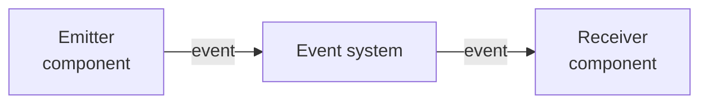
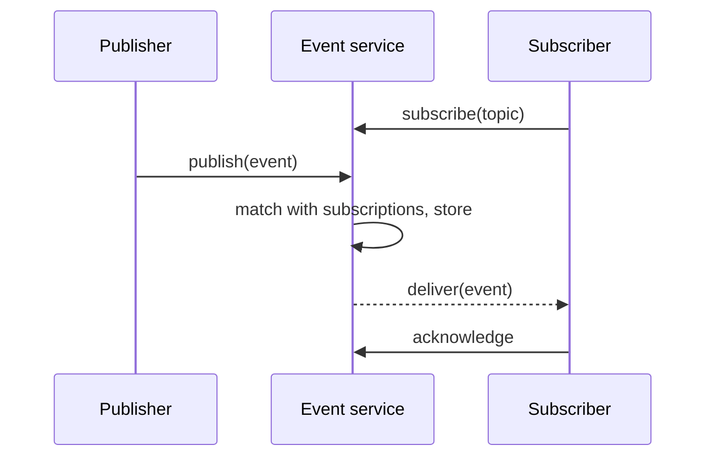
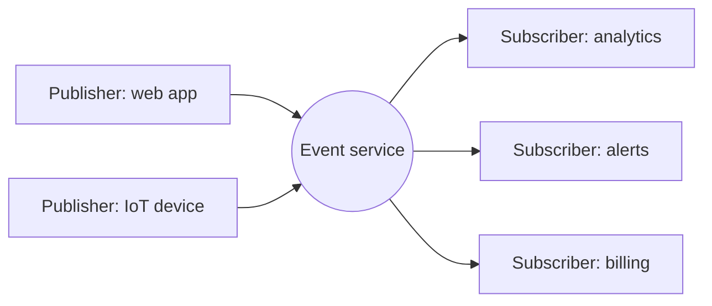
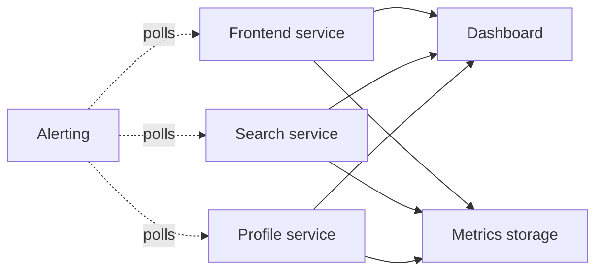
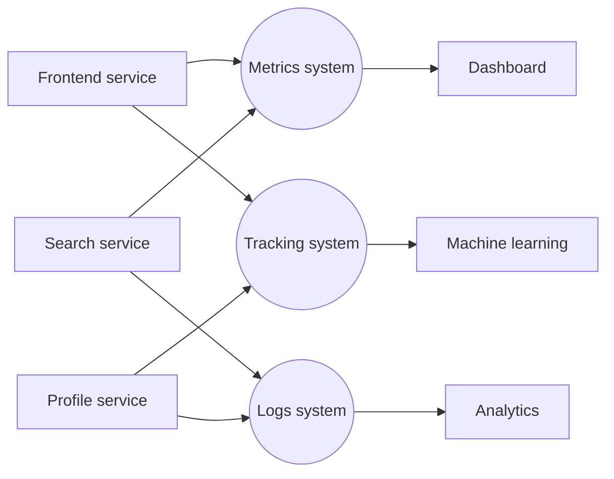
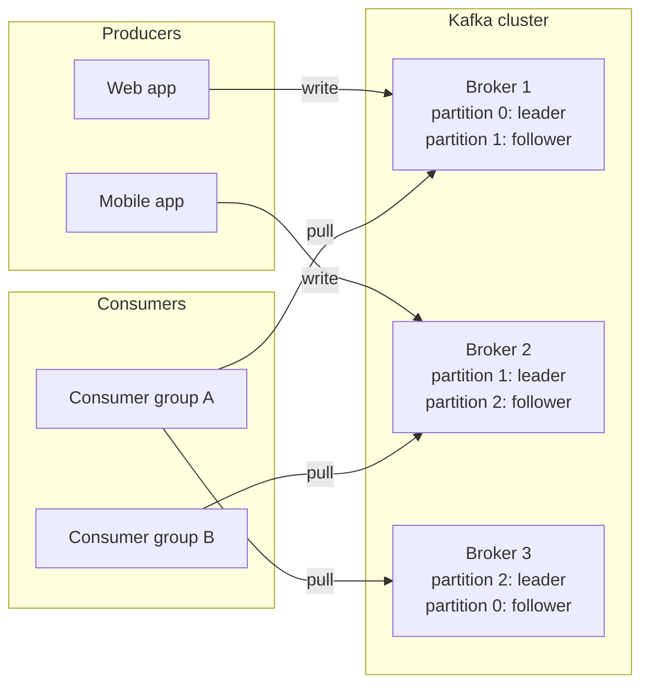
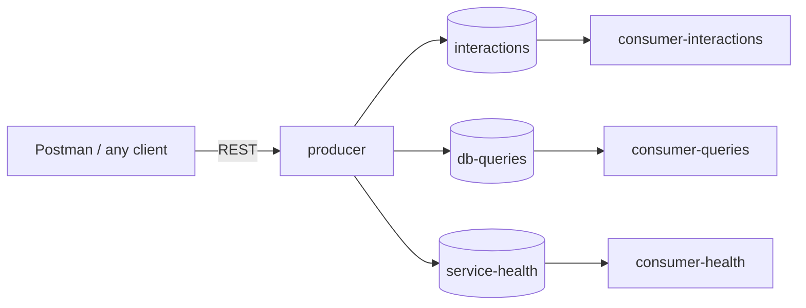

# Event-driven architecture

This repo is an implementation of an **event-driven architecture**. Its purpose is to show how an event-driven architecture works, list its advantages, and explain why this architecture turns out to be really useful when designing systems.

> *This branch is about the **Kafka** implementation. It starts with the theory behind event-driven systems; if you already know it, or it isn't what you're looking for, feel free to jump directly to [Kafka](#kafka)*

---

## Technology

Since there are many different entities involved in the implementation, each tool has a specific role:

- **NestJS** + **TypeScript**: framework and language of every service in the example.
- **Docker Compose**: builds and runs every entity together, with a single command.
- **Postman**: [postman_collection.json](postman_collection.json) lets you test the whole process yourself.

---

## Literature

Event-driven is just a pattern that defines a workflow; any technology is one representation of that theory. Here are some docs about it:

- [What do you mean by "Event-Driven"?](https://martinfowler.com/articles/201701-event-driven.html) — Martin Fowler
- [Formalizing Design Spaces: Implicit Invocation Mechanisms](https://kilthub.cmu.edu/articles/journal_contribution/Formalizing_design_spaces_Implicit_invocation_mechanisms/6605828?file=12096311) — David Garlan, David Notkin
- [An Introduction to Software Architecture](https://userweb.cs.txstate.edu/~rp31/papersSA/intro_softarch.pdf) — David Garlan, Mary Shaw
- [AMQP 0-9-1 specification](https://www.rabbitmq.com/resources/specs/amqp0-9-1.pdf) — the protocol behind RabbitMQ
- [Kafka: a Distributed Messaging System for Log Processing](https://people.csail.mit.edu/matei/courses/2015/6.S897/readings/kafka.pdf) — Jay Kreps, Neha Narkhede, Jun Rao


---

## Theory: implicit invocation

You can find many different implementations or representations of event-driven systems, but all of them come from the same source: **implicit invocation**, as formalized in [Formalizing Design Spaces: Implicit Invocation Mechanisms](https://kilthub.cmu.edu/articles/journal_contribution/Formalizing_design_spaces_Implicit_invocation_mechanisms/6605828?file=12096311). Before starting the explanation, it's important to go over some vocabulary, to make sure both of us are speaking the same language.

### Vocabulary

| Term | Definition |
| --- | --- |
| **Component** | A part of the system. It can contain properties and methods, which can be invoked by the same system or by an external one |
| **System** | A set of components that work together to accomplish a specific goal. It offers a service or executes some kind of operation |
| **Event** | A signal a component announces to say that something happened. Announcing it doesn't execute anything by itself, and the component that announces it doesn't know which methods will run in response, or whether any will |
| **Method** | An operation that can be executed on a component. Its function is to modify the system's state |
| **Property** | A part of a component that holds a value. Its function is to describe part of the component |

### From explicit to implicit invocation

At some point in a workflow, every component in a system needs to invoke an operation on another component. That component could be part of the same system as the invoker, or it could live in another one. When the invoker calls it directly, that is called **explicit invocation**, and it requires direct access to the other component to be able to execute the operation.

Many systems needed this kind of interaction and implemented it in many different ways. That's where **implicit invocation** came from: the main idea behind it is being able to execute operations on other components *without explicitly referencing the target component*.

As [Garlan & Shaw](https://userweb.cs.txstate.edu/~rp31/papersSA/intro_softarch.pdf) describe it, this brings two main benefits:

1. **Reuse:** any component can be added to a system just by registering it for the events of that system, without changing the others.
2. **Easier evolution:** components can be replaced, added or removed without affecting the interfaces of the other components, thanks to the **loose coupling** between them.

We can find many examples of implicit invocation in the tools we use. Just to name a few:

- A version control tool like **Git**, whose hooks run scripts when an event such as a commit happens.
- A **UI** that separates the presentation of the data from the application that manages it, so the views update in response to changes.
- A **database** that ensures its consistency constraints, running checks or triggers when the data changes.

To manage the interaction between components, [Garlan & Notkin](https://kilthub.cmu.edu/articles/journal_contribution/Formalizing_design_spaces_Implicit_invocation_mechanisms/6605828?file=12096311) define two models: a **basic model**, with the entities involved, and a **runtime model**, with how they behave.

### Basic model

Everything starts with the component definition. A component needs three things to be able to interact with the others: a **name** to identify itself, a **set of methods** and a **set of events**.

> *The model also defines two specific functions, one to extract a component's methods and one to extract its events. But since the goal of this document is just to explain how the pattern works, not to get into a specific formalization, I'm going to leave them out of scope.*

Nice, we have a component.

We also have another entity called the **event system**. It holds the components and the **event manager**, which binds each event to the methods that must be invoked when that event is **announced**.

```
Component     = { name, methods, events }
Event system  = { components, event manager }
Event manager : event  →  methods to invoke
```

So the event system is the core part of our model: it manages the behavior of all the events in a system. It has all the context required to manage the invocations and to route each request for execution.

### Runtime model

Now that we understand what an event system is, its parts, and the other entities involved in its definition, the next point is to define how it should behave. It needs two main operations to work as expected:

- The capability to let a component **announce** an event.
- A way to pick one of those events and **invoke** the methods bound to it.

To announce an event, the runtime model establishes a **set of announced events**, which are events that were raised but not yet handled, and a **method to announce** an event. It's simple: that method just adds the new event to the set of announced ones.

On the other side, we have a method to **execute the invocations**: it takes the set of methods bound to an event and invokes them, following the invocation policy the system defines, to change the state of the components in the system.

So the system handles each event in two phases:

1. **Select:** it picks an event and removes it from the set of announced events.
2. **Propagate:** it invokes the methods associated with that event.

> *It's important to understand here that each event has its own set of associated methods. That way, the event manager can invoke exactly those methods without affecting the other parts of the components.*

---

## Use cases

A lot of different technologies were built on top of implicit invocation. But more important than the specific technologies is understanding what we mean when we talk about events: "event-driven" means different things to different people, and each meaning has its own common use cases (see [What do you mean by "Event-Driven"?](https://martinfowler.com/articles/201701-event-driven.html)). Before listing each use case, it's important to understand how the parts of each one mirror the formal definition of implicit invocation.

In each example you're going to see an **emitter** (a component) that announces an event, something like a black box that propagates that event to other parts of the system (the **event system**), and a **receiver** that receives and processes the information (another component).



### Event notification

This is when one part of the system notifies another part about a change in its domain, and the emitter **doesn't wait for an answer**.

This pattern is really useful because it keeps components **loosely coupled**: the emitter doesn't need to know who reacts to the event, so it can respond faster and just delegate the rest of the work to the other components.

### Event-carried state transfer

This is when the event carries **all the data** the receivers need, so they don't have to ask the emitter for more information. That way, each receiver updates **its own local copy** of the state from the events it receives, and works with that copy instead of calling the emitter.

- **Lower latency:** the data a receiver needs is already local.
- **Higher availability:** if the emitter stops working, the receivers can still work, since they already have their own copy of the data.
- **Trade-off:** the data is duplicated, and each copy is only **eventually consistent** with the original.

### Event sourcing

This is when every change to the system's state is stored as an event, so the current state can be **rebuilt by replaying** those events, and any past state can be restored by replaying them up to a given moment. Unlike the Memento pattern, which stores snapshots of the state, it stores the **changes** that produced it.

It's very useful because we can make many changes to our system and, if something goes wrong, we can rebuild it up to the last stable state. The best example to describe this pattern is **Git**: each commit records a change, and from its history you can restore any previous version whenever you want.

> In this kind of implementation, the stored events become the **source of truth** of the system: any other representation of the state is derived from them and can be rebuilt from them.

### CQRS

**Command Query Responsibility Segregation** is not an event-driven pattern itself, but it's important to talk about it because it's commonly combined with one. It establishes that we should **separate writing from reading**:

- **Commands** change the state, and are handled by the write model.
- **Queries** read the state, and are handled by a different read model.

Event-driven systems often use events to keep the read model up to date with the changes made by the write model.

---

## Trade-offs

This is the base that event-driven systems are built on. From here, each one defines and establishes its own workflow, which is why it's common to find many different implementations, depending on the needs of each one. However, all of these patterns share some benefits and challenges that come from their nature, described by both [Garlan & Shaw](https://userweb.cs.txstate.edu/~rp31/papersSA/intro_softarch.pdf) and [Fowler](https://martinfowler.com/articles/201701-event-driven.html).

### Benefits

- **Loose coupling:** components don't reference each other, they only agree on the events. That allows each part to be developed, deployed and managed independently.
- **Easy to extend:** since the event system is responsible for managing the communication, you can easily add new components on either side of the architecture, **producers** or **consumers**, without changing the existing ones.
- **Scalability:** consumers can be scaled independently, and the event system can hold events until they are processed, absorbing load spikes instead of passing them on to the consumers.

### Challenges

- **Delivery guarantees:** once an event is published, how do we make sure it was delivered and processed as expected? Depending on the guarantee (at most once, at least once), an event can be lost or arrive more than once, so consumers often need to be **idempotent**.
- **Consistency:** the producer doesn't know when, or whether, the consumers applied the change, so it can only assume what the new state is. Each part of the system is only **eventually consistent**, and the state it assumes can differ from the real one for a while.
- **Ordering and dependencies between events:** when one event depends on another, keeping them in the right order and handling them correctly can get complicated.
- **Harder to follow the flow:** components give up control over the computation. Since nobody calls anyone directly, an emitter can't know which components will react to its event, or in which order, and the overall behavior isn't visible in any single place of the code.
- **Error handling:** what happens when processing an event fails, and which strategies (retries, dead-letter queues, compensating events) do we have to handle every possible failure in the process?

### When to use it

Despite these challenges, this architecture is very useful, above all to **connect distributed systems**. For example, in **microservices** we can manage the communication between services with an implementation like this one, and it's also very useful for the communication between the stages of a **data pipeline**.

The key is understanding when it's a good moment to use it, knowing the complications it can bring. Some technologies offer features, like **transactions**, that solve part of these challenges, but they don't remove the responsibility of designing the system to handle them.

---
## Publish/subscribe

To talk about event-driven architecture, it's also important to talk about **publish/subscribe** (*pub/sub*), because this pattern shows how many systems communicate with each other. It's closely related to the criteria defined by [implicit invocation](#theory-implicit-invocation), but it presents a way to achieve that invocation over **remote components**.

This pattern arose from the growing demand on systems. As technology evolved and people brought it into their daily lives, that demand pushed us to find new ways to handle the amount of data and users that systems were expected to serve. As [Eugster et al.](https://classpages.cselabs.umn.edu/Spring-2018/csci8980/Papers/PublishSubscribe/many-faces.pdf) put it, the Internet turned distributed systems into *thousands of entities spread all over the world*, and point-to-point, synchronous communication made those applications rigid and hard to evolve.

So we needed a way to exchange information between different kinds of systems while keeping them **loosely coupled**, so that each one can be scaled and maintained independently, without affecting the others.

### Entities

- **Publisher:** the part of the system in charge of notifying others about a change. It publishes events about the changes that may matter to the interested parts of the system, <ins>without directing them to any specific receiver</ins>: it doesn't know who will receive them, or how many ([Kafka: The Definitive Guide](https://assets.confluent.io/m/1b509accf21490f0/original/20170707-EB-Confluent_Kafka_Definitive-Guide_Complete.pdf), chapter 1).
- **Subscriber:** the component that, at some point, expresses its interest in being notified about a change in another system.
- **Event service:** basically, the medium through which all the data flows. It receives different names in the literature: *event notification service* or *software bus* in [Eugster et al.](https://classpages.cselabs.umn.edu/Spring-2018/csci8980/Papers/PublishSubscribe/many-faces.pdf), *information bus*, and **broker** in messaging systems like Kafka. Besides moving the events, it stores the subscriptions and delivers each event to the interested subscribers.
- **Event (or message):** the object that moves through the different parts of the process. It starts with the publisher, which creates it following the requirements of the system and of the subscribers, and it ends once a subscriber has processed it.

These entities interact through a small set of operations ([Eugster et al.](https://classpages.cselabs.umn.edu/Spring-2018/csci8980/Papers/PublishSubscribe/many-faces.pdf), section 2):

| Operation | Called by | What it does |
| --- | --- | --- |
| `subscribe()` / `unsubscribe()` | Subscriber | Registers, or cancels, its interest in a kind of event |
| `publish()` | Publisher | Hands a new event to the event service |
| `advertise()` | Publisher | Optional: announces what kind of events it will publish |
| *notify* | Event service | Delivers the event to every interested subscriber |

### Workflow

There are many ways to implement this pattern, and they differ in how subscribers express which events they want ([Eugster et al.](https://classpages.cselabs.umn.edu/Spring-2018/csci8980/Papers/PublishSubscribe/many-faces.pdf), section 4).

> Message passing, RPC, notifications, shared spaces and message queuing, which the same paper describes in section 3, aren't implementations of pub/sub: they're **alternative communication paradigms**, and the authors compare them with pub/sub precisely to show that none of them fully decouples the participants.

We'll stick to the basic flow:

1. **Define the data:** first, understand what kind of data actually matters to the system.
2. **Subscribe:** the subscribers express their interest in being notified about a specific change.
3. **Publish:** the publisher emits an event.
4. **Route and store:** the event service is the only part of the flow that knows the connected entities. It has the logic to route each message from its starting point to the rest of the components, and it can also store the events until they're delivered.
5. **Notify:** the subscribers are notified about the change and process the event.

At this point we can imagine a kind of **client/server** architecture: the event service is the server, and the publishers and subscribers play the role of clients.



> **Important:** the subscriber isn't always really *notified*. In some models, it's the subscriber that asks the server for new updates. Kafka is a good example: its consumers **pull** messages from the broker at the rate they can sustain, so they're never flooded, and they can rewind and read old messages again ([Kreps et al., 2011](https://people.csail.mit.edu/matei/courses/2015/6.S897/readings/kafka.pdf)).

The **publisher** is also responsible for creating the event, in a predefined format that the subscriber will understand once it reads it. Depending on the implementation, the event can carry **headers**, a **key** and a specific **schema** definition. JSON and XML are common because they're easy to use and human-readable, but they lack strict typing and compatibility between schema versions; that's why many Kafka developers favor **Apache Avro** ([Kafka: The Definitive Guide](https://assets.confluent.io/m/1b509accf21490f0/original/20170707-EB-Confluent_Kafka_Definitive-Guide_Complete.pdf), chapter 1).

The **subscriber**, on the other hand, is responsible for processing the event. It can do anything with it, and it should let the event service know once it has finished. How it does so depends on the system: RabbitMQ takes an acknowledgement per message, while in Kafka the consumer commits the **offset** it has reached, which means it has processed every message before it ([Kreps et al., 2011](https://people.csail.mit.edu/matei/courses/2015/6.S897/readings/kafka.pdf)).

### Architecture

As I mentioned before, the architecture is basically a **client/server** model with three main parts: two clients, the publisher and the subscriber, and one server, the event service.



This **centralized** design is the most common one, but not the only one ([Eugster et al.](https://classpages.cselabs.umn.edu/Spring-2018/csci8980/Papers/PublishSubscribe/many-faces.pdf), section 5.2.1). In a **distributed** architecture there is no central server, and in an **intermediate** one the event service runs as a network of servers. Kafka follows the latter, with a **cluster of brokers**.

This architecture comes with several advantages that are visible at first glance:

- **Loose coupling:** every client is only connected to the event service, and each connection is independent, so each client has its own lifecycle and can scale horizontally as required. That lets clients be added and removed freely. [Eugster et al.](https://classpages.cselabs.umn.edu/Spring-2018/csci8980/Papers/PublishSubscribe/many-faces.pdf) break this decoupling down into three dimensions:

  | Dimension | Publishers and subscribers… |
  | --- | --- |
  | **Space** | don't need to know each other, nor how many of them there are |
  | **Time** | don't need to be connected at the same time: an event published while a subscriber is offline still reaches it later |
  | **Synchronization** | aren't blocked: publishing doesn't wait for anyone, and subscribers are notified asynchronously |

- **Interoperability:** a publisher can be any kind of system: a frontend application, a mobile app, another server or an IoT device.
- **Reliability:** most event services store the events in some way. Together with the acknowledgement policies, that lets events be delivered reliably: if a subscriber fails, the event isn't lost, it waits until the subscriber comes back.

One point against it is that **everything has to go through the server**, which turns it into a **single point of failure**. So how can we prevent a crash from losing all our data? The answer is to distribute the server and keep **replicas** of the data. In Kafka, each partition can be replicated across several brokers of the cluster: one broker is the partition's leader, and if it fails, another broker that holds a replica takes over ([Kafka: The Definitive Guide](https://assets.confluent.io/m/1b509accf21490f0/original/20170707-EB-Confluent_Kafka_Definitive-Guide_Complete.pdf), chapter 1). The number of replicas is set per topic, so the most critical data can have more copies.

> Replication wasn't in Kafka from the start: the [original paper](https://people.csail.mit.edu/matei/courses/2015/6.S897/readings/kafka.pdf) stores each partition on a single broker and lists built-in replication as future work.

# Kafka

Kafka was created at **LinkedIn**, and it was born from a basic problem that had become hard for the systems team to manage. As LinkedIn grew, so did every service it offered, and the team soon found itself with many services producing a lot of different metrics and data, and many other services consuming that data, each one in its own way. Two of them stood out: one system collected system and application metrics, and another tracked user activity, and neither could handle the other's data ([Kafka: The Definitive Guide](https://assets.confluent.io/m/1b509accf21490f0/original/20170707-EB-Confluent_Kafka_Definitive-Guide_Complete.pdf), chapter 1).

It's easy to imagine the picture they had to face: a lot of systems, all connected to each other.



Then the developers started to think about possible solutions. Their first idea was a service in the middle, able to route and manage each kind of data coming from the client-facing services. So, instead of managing that tangle of connections, they would manage one extra service per kind of data: queries, user interactions and service metrics would each be handled by a single service.

That became a problem too. They had gone from synchronizing every producer with every consumer to grouping each service with the data it generates, and synchronizing the consumers of each group. That was still complex: a single client-facing service can generate many different kinds of data, and whoever connected everything had to understand how each flow worked. On top of that, every one of those systems had its own bugs and limitations, and the company had to maintain all of them ([Kafka: The Definitive Guide](https://assets.confluent.io/m/1b509accf21490f0/original/20170707-EB-Confluent_Kafka_Definitive-Guide_Complete.pdf), chapter 1).



That's one point. The other was **scalability**, because the amount of data flowing between those services was huge. In 2011, Kafka at LinkedIn was already taking in **hundreds of gigabytes and close to a billion messages per day** ([Kreps et al., 2011](https://people.csail.mit.edu/matei/courses/2015/6.S897/readings/kafka.pdf)), and by 2015 it had passed **a trillion messages produced and a petabyte consumed every day** ([Kafka: The Definitive Guide](https://assets.confluent.io/m/1b509accf21490f0/original/20170707-EB-Confluent_Kafka_Definitive-Guide_Complete.pdf), chapter 1). With that much data, performance plays a big role, and scaling those systems becomes a very hard challenge.

> The figure of **6 TB per day** that often comes up isn't LinkedIn's: the [original paper](https://people.csail.mit.edu/matei/courses/2015/6.S897/readings/kafka.pdf) quotes it as the volume of user activity events Facebook gathered daily, to show the scale of this kind of data.

So they finally decided to create **Kafka**: a service able to handle large amounts of data at the same time, offering the same interface to every connected entity, and prioritizing the efficiency and reliability of the data it stores. Its original goals were to ([Kafka: The Definitive Guide](https://assets.confluent.io/m/1b509accf21490f0/original/20170707-EB-Confluent_Kafka_Definitive-Guide_Complete.pdf), chapter 1):

- **Decouple** producers and consumers, using a push-pull model.
- **Persist** the messages, so that multiple consumers can read them.
- Optimize for a **high throughput** of messages.
- **Scale horizontally** as the data streams grow.

---

## Parts of the process

Kafka follows the same pattern as [publish/subscribe](#publishsubscribe): basically, it has a publisher, called **producer** in Kafka, a **broker** and a **consumer**. We'll keep the focus on the server, the broker; the other two parts of the flow are basically clients that create and process the information.

Kafka needs to ensure the reliability of the system, and that, together with the speed it promises, raises a lot of challenges. To meet them, it runs as a **cluster**.

### The cluster

A Kafka cluster is a **group of brokers** working together. Each broker is a server of its own, with its own lifecycle, usually on its own machine and with its own address and port. That's what keeps the system working when one of them crashes.

Inside the cluster, roles are assigned **per partition**, not per broker ([Kafka: The Definitive Guide](https://assets.confluent.io/m/1b509accf21490f0/original/20170707-EB-Confluent_Kafka_Definitive-Guide_Complete.pdf), chapters 1 and 5):

| Role | What it does |
| --- | --- |
| **Leader** | The broker that owns a partition: every producer and consumer of that partition works with it |
| **Follower** | A broker that keeps a copy, a **replica**, of a partition, fetching every new message from the leader |
| **Controller** | One broker of the cluster that assigns partitions to brokers and watches for broker failures |

The same broker is the leader of some partitions and a follower of others, so the load is spread across the cluster. The user decides how many copies each topic has, its **replication factor**, so the most critical data can have more replicas than the rest; but each replica always holds the whole partition. The followers that are up to date with the leader are the **in-sync replicas**, and only they can be elected leader if the current one fails. That covers the availability and reliability requirements.

### The broker

The broker is a complete service that stores **topics**: a topic groups data that shares the same characteristics, and the broker manages how that data is stored and requested. It's important to be clear here: in Kafka, the data isn't pushed to the consumers; **the consumers request it**, pulling it at the rate they can sustain ([Kreps et al., 2011](https://people.csail.mit.edu/matei/courses/2015/6.S897/readings/kafka.pdf)). That opens a lot of possibilities, which we'll see below.

### Partitions and logs

Each topic can be split into **partitions**, and each partition follows the data structure of a **log**. A log is very interesting, because its features make the system behave in a specific way, and thanks to them it reaches a high performance.

A log is **completely ordered** and **append-only**, and each partition is one logical log. Physically, the broker splits it into segment files of roughly the same size, and always appends to the last one ([Kreps et al., 2011](https://people.csail.mit.edu/matei/courses/2015/6.S897/readings/kafka.pdf), section 3.1).

Since each partition is a log, we get something else: each record is addressed by its **offset**, and new records are appended in the order they arrive. So each consumer reads from a specific position in the log and only needs to remember the offset it has reached. That also lets a consumer **go back** to old records and process them again, which is an important change compared to queue-based systems, where a consumed message is gone for every other client ([Kafka: The Definitive Guide](https://assets.confluent.io/m/1b509accf21490f0/original/20170707-EB-Confluent_Kafka_Definitive-Guide_Complete.pdf), chapter 1).

```
partition 0   [0] [1] [2] [3] [4] [5] [6] [7]  ◄── the producer appends here
                       ▲               ▲
                       │               └── consumer group B is at offset 6
                       └── consumer group A is at offset 2, and could rewind to 0
```

Another important point is that messages, or events (for Kafka they're the same), don't need an explicit id to be told apart. Since each one is stored in order, its offset is enough to address it, and Kafka avoids the cost of keeping an index from ids to positions ([Kreps et al., 2011](https://people.csail.mit.edu/matei/courses/2015/6.S897/readings/kafka.pdf), section 3.1). That strips the message down to what matters, *a payload of bytes*, and keeps it as lightweight as possible. A message can also carry a **key**, but it's optional, and it's used to choose the partition, not to identify the message. On top of that, moving the tracking of what was read from the server to the consumer lightens the server even more: it only has to store the messages, in order, and that's it.

So we achieve two important things: messages are **lighter**, so they need less space, and the server **answers fast** with the data requested. The paper adds two more reasons behind that speed: the broker doesn't cache messages itself, it relies on the operating system's page cache, and producers and consumers access the segment files **sequentially** ([Kreps et al., 2011](https://people.csail.mit.edu/matei/courses/2015/6.S897/readings/kafka.pdf), section 3.1).

Just one point is missing to complete the system: how are old messages cleaned? Kafka solves it with a really basic feature, a **retention time**, typically **7 days**. The log removes the messages at the oldest offsets once they reach that age, while new ones keep being appended at the end, one after the other, so the system continues without recalculating anything ([Kreps et al., 2011](https://people.csail.mit.edu/matei/courses/2015/6.S897/readings/kafka.pdf)). Two precisions ([Kafka: The Definitive Guide](https://assets.confluent.io/m/1b509accf21490f0/original/20170707-EB-Confluent_Kafka_Definitive-Guide_Complete.pdf), chapters 1 and 2):

- Retention can be set **per topic**, by time or by size, so each stream keeps its data only as long as it's useful.
- It's applied by deleting **whole segment files**, so a message can live a bit longer than the limit, until its segment is closed and expires.

Putting it all together:



---

## Pragmatic implementation

Nice: now that we understand how Kafka works, its parts, its architecture and its components, it's time to dig into the implementation of this repository.

I tried to make this example as realistic as I could, within some limits: for example, I decided not to implement replication, so there's a **single broker**. The idea is to keep the example simple, so anyone can replicate it freely.

Imagine this: we work with **Acme**, a video streaming company. Right now it runs more than **64 services** and has over **10 million users**. Acme started to receive a lot of data from those users, and soon needed to process all of it. First, it needs a system able to keep and manage that amount of data, around **5 TB a day**. It also needs a well-defined process to ensure the integrity of that data, since most of it is critical information, and to make decisions based on what it tells us.

So Acme has three main situations, plus a requirement from a governance institute:

- **Video management:** users can upload their own videos, delete them and request to publish them. Those requests don't need to be processed in near real time, because our employees must review each video to ensure it meets our quality standards.
- **Video metrics:** Acme wants to store metrics about the videos, such as **views**, **clicks** and **scrolls**. That information is very important to understand our users' trends and to make decisions: recommending videos to them, and understanding which videos matter to people, and why.
- **Service health:** because of the large number of services, Acme needs a way to monitor their health, with the events that break each service's limits, such as **costs**, **resource limits** and **outages**. That lets the team understand what happens with each service and improve it.
- **Audit:** finally, an external governance company wants to audit every video the users submit, to prevent illegal content such as explicit sexual content, drugs or violence.

Each situation becomes a topic:

| Situation | Topic | Partitions chosen by | Consumer |
| --- | --- | --- | --- |
| Video management | `db-queries` | The key: the table | `consumer-queries` |
| Video metrics | `interactions` | The producer: one partition per kind of interaction | `consumer-interactions` |
| Service health | `service-health` | The key: the service | `consumer-health` |
| Audit | `db-queries` | Reads the same topic, in its own consumer group | Not implemented, see [Audit mode](#audit-mode) |

## Technical decisions

For this implementation I decided to use **NestJS**, which follows a modular architecture, with layers that keep each responsibility separate.

The most important part here, beyond the code, is the **Kafka server**. It's defined in the `docker-compose.yml` file, and it's the middle point between the services that communicate through it.

On the other hand, I decided to put every publishing behavior into a **single producer service**, with one module per kind of event the users can generate. That's only for the example: in a real implementation, each client-facing interaction would usually have its own service, so the real architecture would be **n-to-n**, with the Kafka server in the middle. The producer exposes a **REST API** to send the messages; I deliberately built it that way to simulate a more realistic approach.

Then there are **three consumers**. Each one is connected only to the Kafka server, so none of them needed a REST API: each consumer connects to the server and processes one kind of data. Since these consumers are loosely coupled, you can **scale** them: launch more instances of a consumer and they join the same consumer group, which splits the topic's partitions between them. Each topic has 3 partitions, so up to 3 instances of a consumer share the work; a fourth one would get no partition and stay idle until another one leaves ([Kafka: The Definitive Guide](https://assets.confluent.io/m/1b509accf21490f0/original/20170707-EB-Confluent_Kafka_Definitive-Guide_Complete.pdf), chapter 4).



## Installing and running the environment

The complete example is wrapped in a `docker-compose.yml` file, so installing and running it is easy. I also created a [Postman collection](postman_collection.json) with every request you can send to follow the complete example.

```bash
docker compose up -d --build
docker compose logs -f consumer-interactions consumer-queries consumer-health
```

Besides, Kafka has a UI manager where you can follow what happens with the messages you send: who receives them and who processes them. Everything this document summarizes is visible there.

| What | Where |
| --- | --- |
| Producer API (Swagger) | [http://localhost:3000/docs](http://localhost:3000/docs) |
| Kafka UI | [http://localhost:8080](http://localhost:8080) |

---

## Design of the solution

First of all, we need to understand the importance of each solution: what value it brings to Acme, and what integrity criteria it needs.

### Queries

Step by step: the queries first. As we mentioned earlier, logs are **ordered in time**, so they're a very good way to replicate the state of a database and to keep an audit over it, because each stored query tells us about a change applied to the database.

So I decided to create a topic for them: **`db-queries`**.

The topic is split into **3 partitions**, and the key of each query is its **table**. Kafka hashes the key to choose the partition, so every query on the same table always lands in the same partition, and is read in the order it was sent. Several tables can share a partition, but a table never spreads across several. What matters to us is storing what happened to each table at each moment. In this case, we use two tables, **users** and **orders**: think of each order as a request to store a video.

At the same time, I implemented a **consumer**. In a real system, its job would be to apply each query to its table and keep track of what's stored at each moment; in this example, it only logs the query.

We can easily see the strength of this design: we have a loosely coupled service that is an expert in databases, and that stores and processes the queries we send. It also scales very well: we only need to launch another instance of the service and connect it to the broker. Great, right?

Now imagine this: the company decides to change its storage. It has been storing the video data in **S3**, and at some point it decides to add **MongoDB**. What does that change imply? With Kafka and this architecture, it only means launching and connecting a new consumer, in a **new consumer group**: each group reads the whole topic independently, without interfering with the others ([Kafka: The Definitive Guide](https://assets.confluent.io/m/1b509accf21490f0/original/20170707-EB-Confluent_Kafka_Definitive-Guide_Complete.pdf), chapter 1). So the old and the new storage receive the same queries, and the new one can even start from the oldest query the topic still keeps. **Zero refactors** in the process, the architecture or the legacy applications. Great, right?

In this case, I decided to define a **lifetime of 7 days**, Kafka's default one, so the data stays stored for all that time and we can review it whenever we need to.

#### Audit mode

One of Acme's requirements is to let the auditor review the queries, to check every video for illegal content. What tools does our architecture give us for that?

First of all, the nature of the system already helps: the logs are kept for 7 days, so the auditor company has a wide window to review each video and submit its findings.

But how would it work technically? Here, it's tempting to think of **replication**, but replication doesn't fit this case: its goal is to keep copies of the data inside the **same cluster**, so another broker can take over if one fails; the copies aren't there to be read by someone else. Kafka offers two better options, and **neither is implemented in this repository**:

- **A new consumer group:** the auditor reads `db-queries` in its own consumer group, and filters the queries on the `orders` table by their key. That needs no copy at all, because each group reads the topic independently. The auditor can then publish its findings to a new topic, such as `audit`.
- **A separate cluster:** if the external company must not access our cluster, the topic can be **mirrored** to another cluster with **MirrorMaker**, Kafka's tool to copy topics between clusters. Isolation for security requirements is one of the reasons to run multiple clusters ([Kafka: The Definitive Guide](https://assets.confluent.io/m/1b509accf21490f0/original/20170707-EB-Confluent_Kafka_Definitive-Guide_Complete.pdf), chapters 1 and 8). There, the auditor gets its own copy of the queries, and can take advantage of everything Kafka offers, connecting as many producers and consumers as it needs.

### Interactions

Nice: the queries are the most critical information to store. The interactions, instead, are a little more flexible: the decisions based on them are made once a lot of data has been processed, so losing some of it along the way isn't a big deal.

In that case, the write policies for this topic could be more flexible: for example, a producer could wait only for the leader to confirm each message (`acks=1`), instead of waiting for every in-sync replica (`acks=all`), which is what this example uses for every topic ([Kafka: The Definitive Guide](https://assets.confluent.io/m/1b509accf21490f0/original/20170707-EB-Confluent_Kafka_Definitive-Guide_Complete.pdf), chapter 3). At the same time, this topic is going to be the **largest one**. Think about it: we need to store a lot of metrics about user behavior, such as which videos they watch, which parts of the page they click and how long they scroll until they find something interesting. Compared to the queries, this topic is going to be huge, and it needs to support a lot of data flowing at the same time. That, together with its lower integrity needs, lets us define a **shorter lifetime** than the queries'.

So I decided to store each kind of interaction in its own partition. What matters to us is how all users together behave in the system; individual users aren't really important for decisions based on trends. That gives **3 partitions**: one for views, one for clicks and one for scrolls. Here the producer chooses the partition itself, instead of letting Kafka hash the key, and each partition keeps the data long enough for our consumers to process it and load it into the big data engines.

| Partition | Interaction |
| --- | --- |
| `interactions-0` | Views |
| `interactions-1` | Clicks |
| `interactions-2` | Scrolls |

Nice, we've solved three of the problems.

### Service health

Nice, finally, one more important kind of data. Acme needs a way to monitor the health of its services, with important data such as **costs**, **resource limits** and **outages**. Each of them matters a lot to the company, but the amount of data to store is very small compared to the other two: Acme runs 64 services, a really limited number next to the 10 million users interacting with them. Still, this pipeline is really critical, because it includes what each service costs the company's budget.

This data should be **replicated**, which this example leaves out by running a single broker, and it must be kept for **at least seven days**: that gives us time to process it and, if we see an abnormal change in the usual behavior, to go back to that day, see what happened and process the information again. In this example, the topic keeps it for **30 days**.

So I decided on **3 partitions** for this topic too, with the **service** as the key: every event of a service lands in the same partition, so the consumer reads them in the order they happened, an outage before the cost it caused. The consumer is connected to them, and the idea is to store that data and chart it later, to make decisions based on its behavior.

---

## Conclusion

The flexibility that event-driven systems offer is a really important tool for any company. Kafka is especially interesting because it handles any kind of message as an abstraction, which lets us generalize the process. This example is a small taste of how Kafka works and of its power: it's designed to support huge amounts of data, and to grow and adapt to whatever comes. I hope this example helps you understand not just how Kafka works, but also the benefits event-driven systems can bring to your company.
