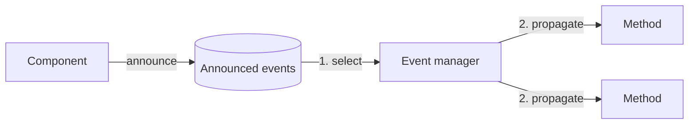
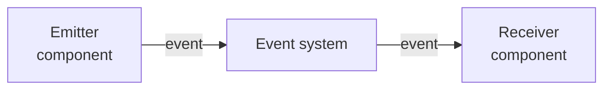

# Event-driven architecture

This repo is an implementation of an **event-driven architecture**. Its purpose is to show how an event-driven architecture works, list its advantages, and explain why this architecture turns out to be really useful when designing systems.

Before starting, I'm going to walk through the definition of an event-driven system. Then I'm going to show two ways to implement this architecture: one with **RabbitMQ** (queues) and the other with **Kafka** (event logs). For that, I decided to split this repo into branches, each one with its specific implementation. Feel free to jump into each one and explore it.

| Branch | Broker | Model |
| --- | --- | --- |
| `main` | None wired up | The shared base. Each implementation branches off from here |
| `stable/rabbit` | RabbitMQ | Message queue: exchanges route messages to queues, and a message is removed once a consumer acknowledges it |
| `stable/kafka` | Kafka | Event log: events are appended to partitioned topics and kept, and each consumer group tracks its own offset |

> By the way, this repo is also meant to work as a **template**, with a working example, so you can clone it and easily adapt it to your own project. For that reason, this documentation is as specific as I can make it, to make sure you understand not just the theory behind it, but also the implementation and its components.

---

## Technology

Since there are many different entities involved in the implementation, each tool has a specific role:

- **NestJS** + **TypeScript**: framework and language of every service in the example.
- **Docker Compose**: builds and runs every entity together, with a single command.
- **Postman**: lets you test the whole process yourself.

---

## Literature

Event-driven is just a pattern that defines a workflow; any technology is one representation of that theory. Here are some docs about it:

- [What do you mean by "Event-Driven"?](https://martinfowler.com/articles/201701-event-driven.html) — Martin Fowler
- [Formalizing Design Spaces: Implicit Invocation Mechanisms](https://kilthub.cmu.edu/articles/journal_contribution/Formalizing_design_spaces_Implicit_invocation_mechanisms/6605828?file=12096311) — David Garlan, David Notkin
- [An Introduction to Software Architecture](https://userweb.cs.txstate.edu/~rp31/papersSA/intro_softarch.pdf) — David Garlan, Mary Shaw
- [AMQP 0-9-1 specification](https://www.rabbitmq.com/resources/specs/amqp0-9-1.pdf) — the protocol behind RabbitMQ
- [Kafka: a Distributed Messaging System for Log Processing](https://people.csail.mit.edu/matei/courses/2015/6.S897/readings/kafka.pdf) — Jay Kreps, Neha Narkhede, Jun Rao

> *I'm not the source of truth here. Feel free to read, research and form your own opinion about it.*

---

## Theory: implicit invocation

You can find many different implementations or representations of event-driven systems, but all of them come from the same source: **implicit invocation**, as formalized in [Formalizing Design Spaces: Implicit Invocation Mechanisms](https://kilthub.cmu.edu/articles/journal_contribution/Formalizing_design_spaces_Implicit_invocation_mechanisms/6605828?file=12096311). Before starting the explanation, it's important to go over some vocabulary, to make sure both of us are speaking the same language.

### Vocabulary

| Term | Definition |
| --- | --- |
| **Component** | A part of the system. It can contain properties and methods, which can be invoked by the same system or by an external one |
| **System** | A set of components that work together to accomplish a specific goal. It offers a service or executes some kind of operation |
| **Event** | A signal a component announces to say that something happened. Announcing it doesn't execute anything by itself, and the component that announces it doesn't know which methods will run in response, or whether any will |
| **Method** | An operation that can be executed on a component. Its function is to modify the system's state |
| **Property** | A part of a component that holds a value. Its function is to describe part of the component |

### From explicit to implicit invocation

At some point in a workflow, every component in a system needs to invoke an operation on another component. That component could be part of the same system as the invoker, or it could live in another one. When the invoker calls it directly, that is called **explicit invocation**, and it requires direct access to the other component to be able to execute the operation.

Many systems needed this kind of interaction and implemented it in many different ways. That's where **implicit invocation** came from: the main idea behind it is being able to execute operations on other components *without explicitly referencing the target component*.


It turned out to be really useful for two reasons:

1. **It simplifies development**, reducing the effort of building complex communication between components to achieve a specific function.
2. **It reduces the cost of evolving systems**, since components can be added, replaced or removed independently without affecting each other, thanks to the **loose coupling** between them.

We can find many examples of implicit invocation in the tools we use. Just to name a few:

- A version control tool like **Git**, whose hooks run scripts when an event such as a commit happens.
- A **UI** where a change in one component makes other components update in response.
- A **database** that ensures its consistency constraints.

So implicit invocation defines some models to manage the interaction between components:

### Basic model

Everything starts with the component definition. A component needs three things to be able to interact with the others: a **name** to identify itself, a **set of methods** and a **set of events**.

> *The model also defines two specific functions, one to extract a component's methods and one to extract its events. But since the goal of this document is just to explain how the pattern works, not to get into a specific formalization, I'm going to leave them out of scope.*

Nice, we have a component.

We also have another entity called the **event system**. It holds the components and the **event manager**, which binds each event to the methods that must be invoked when that event is **announced**.

```
Component     = { name, methods, events }
Event system  = { components, event manager }
Event manager : event  →  methods to invoke
```

So the event system is the core part of our model: it manages the behavior of all the events in a system. It has all the context required to manage the invocations and to route each request for execution.

### Runtime model

Now that we understand what an event system is, its parts, and the other entities involved in its definition, the next point is to define how it should behave. It needs two main operations to work as expected:

- The capability to let a component **announce** an event.
- A way to pick one of those events and **invoke** the methods bound to it.

To announce an event, the runtime model establishes a **set of announced events**, which are events that were raised but not yet handled, and a **method to announce** an event. It's simple: that method just adds the new event to the set of announced ones.

On the other side, we have a method to **execute the invocations**: it takes the set of methods bound to an event and invokes them, following the invocation policy the system defines, to change the state of the components in the system.

So the system handles each event in two phases:

1. **Select:** it picks an event and removes it from the set of announced events.
2. **Propagate:** it invokes the methods associated with that event.



> It's important to understand here that each event has its own set of associated methods. That way, the event manager can invoke exactly those methods without affecting the other parts of the components.

## Use cases

A lot of different technologies were built on top of implicit invocation. But more important than the specific technologies is understanding what we mean when we talk about events: "event-driven" means different things to different people, and each meaning has its own common use cases (see [What do you mean by "Event-Driven"?](https://martinfowler.com/articles/201701-event-driven.html)). Before listing each use case, it's important to understand how the parts of each one mirror the formal definition of implicit invocation.

In each example you're going to see an **emitter** (a component) that announces an event, something like a black box that propagates that event to other parts of the system (the **event system**), and a **receiver** that receives and processes the information (another component).



### Event notification

This is when one part of the system notifies another part about a change in its domain, and the emitter **doesn't wait for an answer**.

This pattern is really useful because it keeps components **loosely coupled**: the emitter doesn't need to know who reacts to the event, so it can respond faster and just delegate the rest of the work to the other components.

### Event-carried state transfer

This is when the event carries **all the data** the receivers need, so they don't have to ask the emitter for more information. That way, each receiver updates **its own local copy** of the state from the events it receives, and works with that copy instead of calling the emitter.

- **Lower latency:** the data a receiver needs is already local.
- **Higher availability:** if the emitter stops working, the receivers can still work, since they already have their own copy of the data.
- **Trade-off:** the data is duplicated, and each copy is only **eventually consistent** with the original.

### Event sourcing

This is when every change to the system's state is stored as an event, so the current state can be **rebuilt by replaying** those events, and any past state can be restored by replaying them up to a given moment. Unlike the Memento pattern, which stores snapshots of the state, it stores the **changes** that produced it.

It's very useful because we can make many changes to our system and, if something goes wrong, we can rebuild it up to the last stable state. The best example to describe this pattern is **Git**: each commit records a change, and from its history you can restore any previous version whenever you want.

> In this kind of implementation, the stored events become the **source of truth** of the system: any other representation of the state is derived from them and can be rebuilt from them.

### CQRS

**Command Query Responsibility Segregation** is not an event-driven pattern itself, but it's important to talk about it because it's commonly combined with one. It establishes that we should **separate writing from reading**:

- **Commands** change the state, and are handled by the write model.
- **Queries** read the state, and are handled by a different read model.

Event-driven systems often use events to keep the read model up to date with the changes made by the write model.

## Conclusion

This is the base that event-driven systems are built on. From here, each one defines and establishes its own workflow, which is why it's common to find many different implementations, depending on the needs of each one. However, all of these patterns share some benefits and challenges that come from their nature.

### Benefits

- **Loose coupling:** components don't reference each other, they only agree on the events. That allows each part to be developed, deployed and managed independently.
- **Easy to extend:** since the event system is responsible for managing the communication, you can easily add new components on either side of the architecture, **producers** or **consumers**, without changing the existing ones.
- **Scalability:** consumers can be scaled independently, and the event system can hold events until they are processed, absorbing load spikes instead of passing them on to the consumers.

### Challenges

- **Delivery guarantees:** once an event is published, how do we make sure it was delivered and processed as expected? Depending on the guarantee (at most once, at least once), an event can be lost or arrive more than once, so consumers often need to be **idempotent**.
- **Consistency:** the producer doesn't know when, or whether, the consumers applied the change, so it can only assume what the new state is. Each part of the system is only **eventually consistent**, and the state it assumes can differ from the real one for a while.
- **Ordering and dependencies between events:** when one event depends on another, keeping them in the right order and handling them correctly can get complicated.
- **Error handling:** what happens when processing an event fails, and which strategies (retries, dead-letter queues, compensating events) do we have to handle every possible failure in the process?

### When to use it

Despite these challenges, this architecture is very useful, above all to **connect distributed systems**. For example, in **microservices** we can manage the communication between services with an implementation like this one, and it's also very useful for the communication between the stages of a **data pipeline**.

The key is understanding when it's a good moment to use it, knowing the complications it can bring. Some technologies offer features, like **transactions**, that solve part of these challenges, but they don't remove the responsibility of designing the system to handle them.
